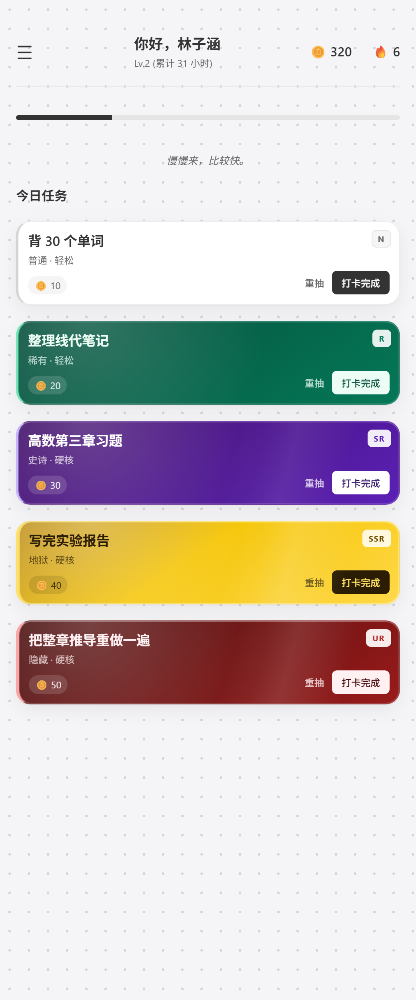

# StudyGacha

一个给所有人用的学习抽卡网页。每天抽三张任务卡，做完打卡，攒学币。

[在线体验](https://famous-treacle-a9b0fe.netlify.app)



## 项目介绍

大家好！我是来自广工的大一新生。这是我想做的一个帮助大家发掘学习乐趣的小网页。

对于我而言，进入大学比较焦虑：不知道该学什么，不知道每天该干什么，因此我做了这样一个网页。大家可以以抽盲盒的形式来完成一天的任务，可以提高自己的学习动力，也提供了一些反馈机制，非常有意思，欢迎大家来试试看哦！

另外，如果有广工或者其他小伙伴愿意来交流，欢迎添加我的邮箱 17841536885@163.com。感谢所有使用的大家，我会继续努力的！

## 功能

- 抽卡：每天 1 张硬核 + 2 张轻松，也可以自选；抽完锁定，每天一次单卡重抽
- 任务库：填难度和意愿，自动算稀有度
- 打卡：输入时长，换学币，累计连击
- 心愿单：用学币兑换自己写的奖励
- 排行榜：按总时长排序，可以看同学今天的任务
- 日历：回看这个月哪天打了卡
- 周末：周六可以补本周没做完的金卡、红卡，周日休息
- 其他：深色模式、分享二维码、新手指引、可安装到桌面

## 技术

前端只有一个 `index.html`，原生 HTML/CSS/JS，没有框架，也没有构建步骤。后端用 Supabase：Auth 管账号，Postgres 存数据，RLS 控制权限。托管在 Netlify。

## 数据表

- `profiles`：昵称、生日、总时长、学币、连击、心愿单、语录、兑换记录
- `tasks`：任务名、难度、意愿、得分、稀有度、类型
- `daily_records`：某天的卡牌、完成时长、获得学币、是否重抽过

建表和 RLS 在 [`sql/`](sql/) 里。

## 几个设计说明

### 稀有度

```
挑战值 = 难度(1-10) + (11 - 意愿(1-10))   // 2 到 20
十分制 = 挑战值 / 2                        // 1 到 10
```

| 十分制 | 稀有度 | 卡池  |
| --- | --- | --- |
| < 2 | 普通  | 轻松  |
| < 4 | 稀有  | 轻松  |
| < 6 | 史诗  | 硬核  |
| < 8 | 地狱  | 硬核  |
| ≥ 8 | 隐藏  | 硬核  |

### 每天锁定

抽完就不能换，避免反复挑。每天一次单卡重抽，给“抽错了”留一个出口。

### 周末

周六把本周一到周五没做完的地狱、隐藏卡拉出来，补做后写回原来那天，周报不会算错。周日不抽卡。

### 22:00

到点如果还有没做完的卡，页面会提示可以停了，不扣学币也不影响连击。这个提醒是我自己需要的，不是给用户加压力。

## 遇到的问题

- **时区**：一开始用 `toISOString()` 取日期，国内凌晨 0 到 8 点会把打卡记到前一天。后来写了 `localDateStr()` 统一用本地日期。
- **权限**：RLS 只允许改自己的行，所以“戳一戳”不能直接改别人的资料，最后写了一个数据库函数。
- **兼容**：百度浏览器不支持 `??`，整个脚本解析失败，登录按钮全部失效。改成 ES5 写法后正常。
- **加载**：Supabase 的脚本原来放在 `head`，网络慢时页面一直白屏。移到 `body` 末尾后先显示界面。
- **部署**：Netlify 现在新项目默认私有，外部访问是 401，要在设置里改成 public。

## 目前的问题

- 忘记密码找不回。没绑真实邮箱，密保功能也没启用。
- 网络不稳。Netlify 和 Supabase 都在境外，有些手机流量或微信里会打不开。
- 排行榜所有人都能看到，没有好友申请。
- 学币和时长是前端算完再写库的，没有事务。
- 二维码用的是第三方接口，接口挂了就只能复制链接。

## 本地运行

1. 建一个 Supabase 项目，执行 `sql/schema.sql` 和 `sql/policies.sql`
2. 打开 `index.html`，把 `SUPABASE_URL` 和 `SUPABASE_KEY` 换成自己的
3. 用浏览器打开，或者起一个静态服务器

## 部署

Netlify 拖 `deploy/` 文件夹。更新的时候进现有站点的 **Deploys** 再拖一次，不要新建站点，不然网址会变。

## 安装到桌面

这是一个 PWA，可以像 App 一样装到桌面：

- Android Chrome：打开网站 → 右上角菜单 → 安装应用 / 添加到主屏幕
- iPhone Safari：分享 → 添加到主屏幕

装好后从桌面图标打开，没有地址栏。首次打开会缓存界面，断网也能打开页面，但登录和读写数据仍然需要联网。

## 后面想做的

- 账号找回
- 打卡和兑换改成数据库事务
- 任务库支持编辑
- 好友系统
- 国内后端，解决网络问题

## 致谢

Supabase 提供了数据库和登录，DeepSeek 帮我改了很多代码。还有几个同学愿意试用，提了不少意见,谢谢所有帮助我的人!!
